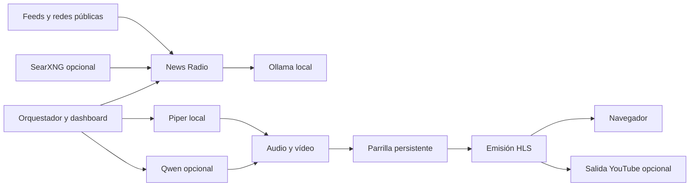

# Arquitectura

## Procesos

- `bootstrap`: inicializa configuraciones y permisos; termina. Los servicios
  esperan su finalización correcta antes de usar los volúmenes.
- `ollama`: API interna, con un modelo simultáneo y sin permanencia por defecto.
- `news-radio`: catálogo, caché de fuentes, extracción, redacción y valoración.
- `orchestrator`: ciclo de actualización, producción secuencial, Piper y dashboard.
- `broadcaster`: reloj independiente de publicación HLS, sin inferencias de IA.
- `qwentts`: biblioteca y síntesis por fragmentos, activado con perfil `qwen`.
- `youtube`: consume HLS por HTTP y envía RTMPS, activado con perfil `youtube`.

La red bridge de Compose resuelve `news-radio`, `ollama`, `qwentts` y `orchestrator`.
No se requiere red host ni IP fija. Las consultas loopback de los healthchecks son
intencionadas: comprueban el proceso dentro de su propio contenedor.

Ollama y Qwen usan sus APIs internas. Un archivo compartido en `state/ai-runtime/`
serializa las inferencias coordinadas por la aplicación; las llamadas manuales
directas a Ollama fuera del sistema no están protegidas por ese bloqueo.

## Datos

SQLite y todos los archivos operativos viven en `state/`, montados por bind para
que sean accesibles y copiables. Orquestador y broadcaster comparten la base de
parrilla y los archivos HLS. Mantenerlos separados conserva la emisión mientras
se generan noticias. Los procesos comparten los bloqueos de selección y retirada.

News Radio es propietario de su catálogo y su caché. Qwen es propietario de voces,
pesos y audios. El orquestador utiliza sus APIs y conserva los identificadores de
trabajos para recuperar operaciones interrumpidas sin duplicarlas.

`playlist_rotation.py` decide renovación por fecha de incorporación.
`balancing.py` y `relevance_policy.py` eligen candidatas sin conservar indefinidamente
noticias ya emitidas. La limpieza retira sus archivos al terminar la reproducción.

## Límites y alcance

CPU y RAM se limitan por servicio. La suma de límites no implica una reserva de
memoria. El perfil de CPU es el empaquetado inicial; no se añade GPU ni Kubernetes.
No se incorpora un nuevo backend de noticias ni se cambian los prompts para el
empaquetado. Los servicios ya existentes siguen siendo la base funcional.
